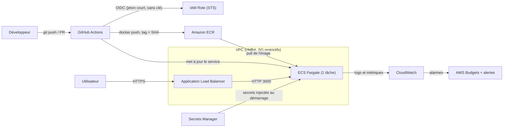

# devsecops-tp

[](https://github.com/OWNER/devsecops-tp/actions/workflows/ci.yml)
[](https://github.com/OWNER/devsecops-tp/security/code-scanning)

API Node.js (Express) rendue « prête pour la prod » dans le cadre du TP de clôture CI/CD (Mastère 1 Full Stack).

```bash
npm ci && npm test        # tests
npm start                 # API sur http://localhost:3000  (voir .env.example)
```

> Remplace `OWNER` par ton nom d'utilisateur GitHub dans les badges. Le badge CodeQL pointe vers le workflow
> `codeql.yml` créé par la configuration par défaut ; si le nom diffère, copie l'URL depuis l'onglet Actions.

---

## Sécurité & coûts

### 1. Secrets

- **Secret Protection** et **Push protection** activés (Settings → Code security) : capture dans `docs/secret-protection.png`
  *(à ajouter avant le rendu)*.
- `.gitignore` (`node_modules/`, `.env`, `coverage/`, `*.log`) et `.env.example` (`PORT=3000`, aucune valeur secrète).

**Question : un collègue a poussé une vraie clé AWS il y a 3 jours, puis l'a supprimée dans un nouveau commit.**

Je lui réponds que « elle n'est plus là » est faux : le commit initial contient toujours la clé dans l'historique Git
(et dans tous les clones, forks et caches). Sur un dépôt public, des robots scannent les nouveaux commits en quelques
minutes : en 3 jours, la clé doit être considérée comme **compromise**. Dans l'ordre :

1. **Révoquer tout de suite** la clé (IAM → désactiver puis supprimer la clé d'accès). C'est la seule action qui
   neutralise la fuite.
2. **Auditer l'usage** depuis la date du push (CloudTrail, Cost Explorer) : instances ou ressources inconnues, accès
   à des données, changements IAM. Supprimer ce que l'attaquant a créé et traiter les données exposées.
3. **Émettre un nouveau secret** si nécessaire, hors du code (Secrets Manager / secrets GitHub), ou mieux : plus de clé
   longue durée du tout (rôle IAM + OIDC, voir bonus).
4. *(Optionnel, cosmétique)* réécrire l'historique (`git filter-repo` / BFG) puis force-push. Cela n'annule pas la
   compromission : la révocation est faite à l'étape 1.
5. **Prévenir** : push protection activée, post-mortem, pre-commit hook de détection de secrets.

### 2. Dépendances

`dependabot.yml` couvre **npm**, **github-actions** et **docker**. Le job `deps-audit` lance
`npm audit --audit-level=high` : rouge avec `express 4.17.1` / `lodash 4.17.15`, vert après mise à jour
(`express 4.22.3`, `lodash 4.18.1`). Les tests restent verts.

| | Critical | High | Moderate | Low |
|---|---|---|---|---|
| **Avant** (toutes dépendances) | 0 | 5 | 16 | 7 |
| **Après** (toutes dépendances) | 0 | 0 | 16 | 4 |
| *Avant (prod seule, `--omit=dev`)* | 0 | 5 | 0 | 3 |
| *Après (prod seule, `--omit=dev`)* | 0 | 0 | 0 | 0 |

Avant : `express` (via `body-parser`, `path-to-regexp`, `qs`) et `lodash`. Après : il ne reste que la chaîne
transitive de `jest` (outil de test, jamais dans l'image), non bloquante car sous le seuil `high`.
*(Chiffres relevés le jour de la rédaction : l'audit évolue, relance `npm audit` pour les valeurs du jour.)*

### 3. Les 3 failles du code

| Route | Faille | URL d'attaque | Ce que ça permet | Correction |
|---|---|---|---|---|
| `/hello` (l. 12) | **XSS réfléchie** (CWE-79) | `/hello?name=%3Cscript%3Ealert(document.cookie)%3C/script%3E` | Exécuter du JavaScript dans le navigateur de la victime qui ouvre le lien : vol de session, redirection, phishing | `_.escape(name)` avant insertion HTML, type vérifié (`string`) |
| `/ping` (l. 17) | **Injection de commande** (CWE-78) | `/ping?host=127.0.0.1%3Bcat%20/etc/passwd` | Exécuter n'importe quelle commande shell sur le serveur (lecture de fichiers, variables d'environnement, reverse shell) | Validation stricte de l'hôte (IPv4 / nom DNS) + `execFile('ping', ['-c','1',host])` : pas de shell, hôte jamais interprété comme option |
| `/prefs` (l. 26) | **Pollution de prototype / mass assignment** (CWE-1321, CWE-915) | `/prefs?constructor[prototype][isAdmin]=true` (ou `?__proto__[isAdmin]=true`) | Faire fusionner des clés arbitraires de l'utilisateur dans un objet serveur via `_.merge` : injection de propriétés, et pollution de `Object.prototype` (donc de tous les objets) selon la version de lodash / qs | Suppression de `_.merge` sur `req.query` : liste blanche de clés (`theme`, `lang`) et de valeurs |

Notes :
- **CodeQL** signale en général `/hello` (`js/reflected-xss`) et `/ping` (`js/command-line-injection`). La troisième
  se trouve en lisant le code : de la donnée utilisateur dans un `merge` récursif. Reporte ici la règle, le fichier,
  la ligne et la gravité exactes de tes alertes (onglet Security → Code scanning).
- Sur l'URL de `/prefs` : testée en local avec les versions d'origine, la clé `constructor.prototype.isAdmin` est bien
  acceptée et reflétée dans la réponse (injection de clés arbitraires) ; la pollution globale de `Object.prototype`
  dépend des versions de lodash et qs (les anciennes versions sont connues pour être vulnérables). Le défaut de
  conception (merge de données non fiables) est dans tous les cas la faille.
- Correctif sur la branche `fix/security`, avec un test de régression par faille dans `tests/security.test.js`. Les
  10 tests qui ciblent des comportements dangereux **échouent** avec l'ancien code (vérifié) et passent avec le nouveau.

### 4. Pipeline durci (`.github/workflows/ci.yml`)

- Déclencheurs : `pull_request` et `push` sur `main` uniquement
- `permissions: contents: read` en haut du fichier
- `timeout-minutes` sur chaque job
- `npm ci` + `cache: npm`
- `concurrency` avec `cancel-in-progress: true`
- **Toutes les actions épinglées par SHA de commit** (avec le tag en commentaire), dont `aquasecurity/trivy-action`
  (`@ed142fd0…` = v0.36.0)
- Branche `main` protégée : PR obligatoire, checks `test`, `deps-audit` et CodeQL obligatoires
  (`scripts/setup-github.sh`)

**Question : `trivy-action@v0.34.0` était-il touché en mars 2026 ? Et épinglé par SHA ?**

- **`@v0.34.0` : oui, très probablement.** Un tag Git est un pointeur **mutable** : son propriétaire (ou un attaquant
  qui a pris la main sur le dépôt) peut le déplacer vers un autre commit. Avec 76 tags sur 77 redirigés, un workflow
  qui référence un tag exécute le code malveillant à son prochain run, sans qu'une ligne de son fichier ait changé.
  *(Sauf s'il s'agit du seul tag épargné : à vérifier dans l'avis officiel.)*
- **Épinglé par SHA : non touché.** Un SHA de commit est un hash du contenu : il désigne toujours exactement le même
  code, et personne ne peut le « rediriger ». Condition : le SHA doit avoir été choisi **avant** la compromission (ou
  vérifié), et non copié depuis un tag déjà détourné. Attention : on épingle le SHA du **commit** (`git ls-remote …
  refs/tags/vX^{}` pour un tag annoté), pas celui de l'objet tag.

### 5. Image Docker

Dockerfile multi-stage : étape `deps` (`npm ci --omit=dev`), image finale `node:22.21.1-alpine3.22` avec uniquement
`node_modules`, `package*.json` et `src/`, `USER node`, `CMD ["node", "src/index.js"]`, `.dockerignore`,
`package*.json` copiés avant le code pour le cache.

**Questions sur l'image naïve** (`COPY . .`, sans `.dockerignore`) :
- La couche la plus lourde est celle de l'image de base `node:22` (Debian complète, avec compilateurs et outils de
  build), suivie de `npm install` (dépendances de dev incluses, car `jest` et `supertest` sont installés).
- Un fichier `.env` **serait dans l'image** : `COPY . .` copie tout, et il reste lisible dans la couche
  (`docker history`, `docker save`) même si on le supprime plus tard.
- Le dossier `.git` aussi : tout l'historique, donc d'éventuels secrets déjà supprimés, partirait dans l'image.

| Image | Taille | Nb de couches | CVE HIGH | CVE CRITICAL |
|---|---|---|---|---|
| Naïve (`node:22`) | à mesurer | à mesurer | à mesurer | à mesurer |
| Optimisée | à mesurer | à mesurer | à mesurer | à mesurer |

Commandes de mesure : `docker images devsecops-tp`, `docker history devsecops-tp:<tag>`,
`docker run --rm -v /var/run/docker.sock:/var/run/docker.sock aquasec/trivy:0.74.0 image --severity HIGH,CRITICAL <image>`.

Job CI `image` : dépend de `test` et `deps-audit`, build avec cache GitHub (`type=gha`), scan Trivy
(`ignore-unfixed: true`, `exit-code: 1` sur HIGH/CRITICAL corrigeable).

### 6. AWS et coûts (sur papier, aucune ressource créée)



Coût mensuel de l'API (ECS Fargate, 0,25 vCPU, 0,5 Go, us-east-1, prix de l'énoncé) :

| Scénario | Heures / mois | Calcul | Coût / mois |
|---|---|---|---|
| A. x86, 24h/24 | 730 | 0,25 × 0,04048 × 730 + 0,5 × 0,004445 × 730 = 7,3876 + 1,6224 | **≈ 9,01 $** |
| B. ARM, 24h/24 | 730 | 0,25 × 0,03238 × 730 + 0,5 × 0,003556 × 730 = 5,9093 + 1,2979 | **≈ 7,21 $** |
| C. x86, éteint la nuit et le week-end (12 h × 5 j) | 260 | 12 × 5 × 52 / 12 = 260 h ; 0,25 × 0,04048 × 260 + 0,5 × 0,004445 × 260 = 2,6312 + 0,5778 | **≈ 3,21 $** |

ARM économise ~20 % (B vs A) ; éteindre hors heures de bureau économise ~64 % (C vs A) mais n'a de sens qu'en
dev/test.

**Question : NAT Gateway à 0,045 $ / heure.** 0,045 × 730 = **32,85 $ / mois**, même sans trafic (plus 0,045 $ par Go
traité). C'est **≈ 3,6 fois** le coût de la tâche Fargate du scénario A (9,01 $). Conclusion : sur une petite
charge, le réseau coûte plus cher que le calcul. On choisit l'architecture en regardant le coût de **tous** les
composants, pas seulement l'application. Pistes : une seule NAT en dev, tâches en sous-réseau public avec groupe de
sécurité strict (IPv4 publique facturée, mais bien moins qu'une NAT), VPC endpoints ciblés (S3 gratuit en
gateway). Toujours confirmer avec l'AWS Pricing Calculator.

Lifecycle policy ECR : `aws/ecr-lifecycle.json` (ne garde que les 10 images les plus récentes).

Règle d'entreprise : un budget AWS avec alertes est créé **avant** la première ressource.

### 7. Bonus : déploiement par OIDC (`.github/workflows/deploy-aws.yml`)

Sur push sur `main` : OIDC (`configure-aws-credentials`, aucune clé AWS), connexion ECR, build et push de l'image
taguée `github.sha` (jamais `latest`), rendu de `aws/task-definition.json` puis mise à jour du service ECS.
`id-token: write` uniquement sur le job `deploy`, `environment: production`, `concurrency`, `needs: verify`
(test + audit rejoués dans le même workflow, car `needs` ne traverse pas les workflows). Le job ne tourne que si
`vars.AWS_ENABLED == 'true'` : sans compte AWS, il est ignoré.
