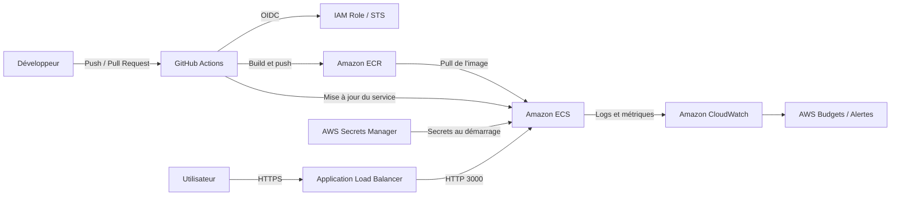

# DevSecOps TP — API Node.js sécurisée et pipeline CI/CD

[](https://github.com/cyprien9694/TDD_Integration_Continue-P3_B3/actions/workflows/ci.yml)

[](https://github.com/cyprien9694/TDD_Integration_Continue-P3_B3/security/code-scanning)

[](https://github.com/cyprien9694/TDD_Integration_Continue-P3_B3/network/updates)

API REST Node.js / Express développée dans le cadre du TP de clôture CI/CD du Mastère 1 Full Stack.

Ce projet vise à appliquer une démarche **DevSecOps** sur l'ensemble du cycle de développement : sécurisation du code, gestion des dépendances, tests automatisés, construction d'une image Docker minimale, analyse des vulnérabilités et préparation d'un déploiement cloud avec AWS.

---

## Sommaire

- [1. Présentation du projet](#1-présentation-du-projet)
- [2. Installation et démarrage](#2-installation-et-démarrage)
- [3. Architecture du projet](#3-architecture-du-projet)
- [4. Sécurité applicative](#4-sécurité-applicative)
- [5. Gestion des secrets](#5-gestion-des-secrets)
- [6. Dépendances et audit](#6-dépendances-et-audit)
- [7. Pipeline CI/CD](#7-pipeline-cicd)
- [8. Conteneurisation Docker](#8-conteneurisation-docker)
- [9. Déploiement AWS et maîtrise des coûts](#9-déploiement-aws-et-maîtrise-des-coûts)
- [10. Bilan et vérifications](#10-bilan-et-vérifications)

---

## 1. Présentation du projet

L'objectif est de transformer une API Node.js initialement vulnérable en une application mieux sécurisée et intégrée dans une chaîne CI/CD automatisée.

### Objectifs techniques

| Domaine | Mise en œuvre |
|---|---|
| Développement | Node.js et Express |
| Tests | Jest et Supertest |
| Sécurité du code | Corrections des vulnérabilités applicatives |
| Secrets | `.gitignore`, `.env.example`, Secret Protection et Push Protection |
| Dépendances | Dependabot et `npm audit` |
| CI/CD | GitHub Actions |
| Analyse de code | CodeQL |
| Conteneurisation | Docker multi-stage |
| Scan d'image | Trivy |
| Cloud | AWS ECR, ECS Fargate et IAM OIDC |

### Principe général

Le pipeline vérifie le code avant de produire une image Docker. Les contrôles de tests et de dépendances doivent réussir avant que l'image soit construite et analysée.

---

## 2. Installation et démarrage

### Prérequis

- Node.js 22
- npm
- Git
- Docker Desktop (pour les tests de conteneurisation)

### Installation

```bash
git clone https://github.com/cyprien9694/TDD_Integration_Continue-P3_B3.git
cd TDD_Integration_Continue-P3_B3
npm ci
```

### Configuration

Créer un fichier `.env` à partir de l'exemple :

```bash
cp .env.example .env
```

Contenu de `.env.example` :

```env
PORT=3000
```

Aucune donnée sensible ne doit être placée dans ce fichier.

### Lancement

```bash
npm test
npm start
```

L'API est accessible à l'adresse :

```text
http://localhost:3000
```

---

## 3. Architecture du projet

```text
.
├── .github/
│   ├── workflows/
│   │   ├── ci.yml
│   │   └── deploy-aws.yml
│   └── dependabot.yml
├── aws/
│   ├── ecr-lifecycle.json
│   └── task-definition.json
├── docs/
├── src/
│   └── index.js
├── tests/
│   └── security.test.js
├── .dockerignore
├── .env.example
├── .gitignore
├── Dockerfile
├── package.json
├── package-lock.json
└── README.md
```

Les principaux éléments sont :

- `src/` : code source de l'API.
- `tests/` : tests automatisés et tests de régression de sécurité.
- `.github/workflows/` : pipelines CI/CD.
- `aws/` : configuration de préparation du déploiement AWS.
- `Dockerfile` : construction de l'image sécurisée.
- `.dockerignore` : exclusion des fichiers inutiles ou sensibles du contexte Docker.

---

## 4. Sécurité applicative

Trois vulnérabilités ont été étudiées et corrigées.

### 4.1 Cross-Site Scripting (XSS) — CWE-79

**Route concernée :** `/hello`

Exemple de requête malveillante :

```text
/hello?name=%3Cscript%3Ealert(document.cookie)%3C/script%3E
```

**Risque :** une entrée utilisateur injectée directement dans une réponse HTML peut entraîner l'exécution de JavaScript dans le navigateur de la victime.

**Correction :**
- Échapper les caractères HTML avec `_.escape(name)`.
- Vérifier que la donnée reçue est bien une chaîne de caractères.
- Ne jamais considérer une entrée utilisateur comme du HTML fiable.

### 4.2 Injection de commande — CWE-78

**Route concernée :** `/ping`

Exemple de requête malveillante :

```text
/ping?host=127.0.0.1%3Bcat%20/etc/passwd
```

**Risque :** une commande construite à partir d'une entrée utilisateur peut permettre l'exécution de commandes arbitraires sur le serveur.

**Correction :**
- Valider strictement le nom d'hôte ou l'adresse IP.
- Utiliser `execFile()` plutôt que `exec()`.
- Passer les arguments séparément, sans interprétation par un shell.
- Empêcher les valeurs commençant par `-` d'être interprétées comme des options.

### 4.3 Pollution de prototype et mass assignment — CWE-1321 / CWE-915

**Route concernée :** `/prefs`

Exemple de paramètre malveillant :

```text
/prefs?constructor[prototype][isAdmin]=true
```

**Risque :** fusionner récursivement des données non fiables dans des objets applicatifs peut introduire des propriétés inattendues et, selon les bibliothèques et versions utilisées, contribuer à une pollution de prototype.

**Correction :**
- Supprimer la fusion récursive de données utilisateur non fiables.
- Utiliser une liste blanche de propriétés autorisées (`theme`, `lang`).
- Valider les valeurs acceptées.
- Ne jamais fusionner directement `req.query` dans un objet de confiance.

### Tests de régression

Les tests de sécurité sont regroupés dans :

```text
tests/security.test.js
```

Les tests permettent de vérifier que les comportements vulnérables sont bloqués après correction.

Les dix tests ciblant les comportements dangereux ont été vérifiés : ils échouent avec l'ancien code vulnérable et passent avec le code corrigé.

**CodeQL :** les alertes de type XSS réfléchie et injection de commande peuvent être identifiées automatiquement. La pollution de prototype nécessite également une analyse du traitement des données et des opérations de fusion.

---

## 5. Gestion des secrets

### 5.1 Protection du dépôt

Les protections prévues ou activées comprennent :

- GitHub Secret Protection.
- GitHub Push Protection.
- `.gitignore` pour exclure les fichiers sensibles.
- `.env.example` pour documenter les variables nécessaires sans exposer de secrets.

Exemple de règles `.gitignore` :

```gitignore
node_modules/
.env
coverage/
*.log
```

Une capture de la configuration GitHub peut être ajoutée dans :

```text
docs/secret-protection.png
```

### 5.2 Que faire après la publication d'une clé AWS ?

**Situation :** un collègue a publié une véritable clé AWS dans un commit, puis l'a supprimée dans un commit suivant.

La suppression du fichier ou de la ligne ne suffit pas. Le secret reste potentiellement présent dans l'historique Git, les clones, les forks et les caches.

Une clé publiée doit être considérée comme compromise.

**Procédure de réponse à incident :**

1. **Révoquer immédiatement la clé.** Désactiver puis supprimer la clé d'accès compromise dans IAM. Cette action empêche son utilisation future.
2. **Auditer les activités.** Examiner CloudTrail, les ressources AWS créées, les accès aux données et les dépenses depuis la date de publication.
3. **Remplacer le secret si nécessaire.** Utiliser un nouveau secret stocké dans un gestionnaire adapté, jamais dans le code source.
4. **Nettoyer éventuellement l'historique Git.** `git filter-repo` ou BFG peuvent supprimer les occurrences historiques, mais cela ne remplace jamais la révocation.
5. **Prévenir une nouvelle fuite.** Activer Push Protection, mettre en place des contrôles de secrets et sensibiliser l'équipe.

### 5.3 Préférence pour OIDC

Pour le déploiement AWS, le projet privilégie GitHub OIDC.

L'objectif est d'utiliser un rôle IAM temporaire plutôt que des clés d'accès AWS permanentes stockées dans GitHub.

---

## 6. Dépendances et audit

### 6.1 Dependabot

Le fichier `.github/dependabot.yml` configure les mises à jour hebdomadaires pour :

- npm ;
- GitHub Actions ;
- Docker.

### 6.2 Audit npm

Le contrôle de sécurité est exécuté avec :

```bash
npm audit --audit-level=high
```

Les vulnérabilités de niveau `high` ou `critical` entraînent l'échec du contrôle.

### 6.3 Évolution de l'audit

Résultats relevés lors de l'analyse initiale et après mise à jour des dépendances :

| Périmètre | État | Critical | High | Moderate | Low |
|---|---|---:|---:|---:|---:|
| Toutes les dépendances | Avant | 0 | 5 | 16 | 7 |
| Toutes les dépendances | Après | 0 | 0 | 16 | 4 |
| Production uniquement | Avant | 0 | 5 | 0 | 3 |
| Production uniquement | Après | 0 | 0 | 0 | 0 |

Les dépendances applicatives ont notamment été mises à jour :

- Express : `4.22.3`
- Lodash : `4.18.1`

Les vulnérabilités restantes dans l'ensemble des dépendances concernent principalement la chaîne de dépendances des outils de développement et de test.

Les dépendances de développement ne sont pas incluses dans l'image de production construite avec `npm ci --omit=dev`.

> Ces chiffres correspondent à un relevé ponctuel. Les résultats peuvent évoluer avec les nouvelles publications de vulnérabilités. Pour obtenir les valeurs actuelles, relancer `npm audit`.

---

## 7. Pipeline CI/CD

Le workflow principal est :

```text
.github/workflows/ci.yml
```

### 7.1 Déclencheurs

- Push sur `main`.
- Pull requests.

### 7.2 Contrôles exécutés

| Job | Objectif |
|---|---|
| `test` | Installer les dépendances et exécuter Jest |
| `deps-audit` | Vérifier les vulnérabilités npm |
| `image` | Construire l'image Docker et exécuter Trivy |

Le job `image` dépend de la réussite de `test` et `deps-audit`.

### 7.3 Mesures de durcissement

Le pipeline intègre notamment :

- `permissions: contents: read` par défaut.
- Des permissions limitées aux besoins de chaque job.
- `timeout-minutes` pour éviter les exécutions interminables.
- `npm ci` pour une installation reproductible.
- Le cache npm.
- `concurrency` et `cancel-in-progress: true`.
- Des actions GitHub épinglées par SHA de commit, avec leur version indiquée en commentaire.
- Un scan de sécurité de l'image Docker avec Trivy.

### 7.4 Protection de la branche principale

La branche `main` doit être protégée avec :

- Pull Request obligatoire.
- Vérifications CI obligatoires.
- Vérification des tests.
- Audit des dépendances.
- Contrôle CodeQL.

Le script `scripts/setup-github.sh` accompagne la configuration de ces protections.

### 7.5 Pourquoi épingler les actions par SHA ?

Un tag Git tel que `@v0.34.0` peut être déplacé vers un autre commit. Un workflow qui référence uniquement ce tag peut donc exécuter du code différent sans modification de son propre fichier.

L'épinglage par SHA permet de référencer un commit précis.

**Attention :** le SHA doit être vérifié et provenir d'une source fiable. Épingler un SHA récupéré depuis un tag déjà compromis ne protège pas contre la compromission initiale.

---

## 8. Conteneurisation Docker

### 8.1 Construction multi-stage

Le Dockerfile utilise plusieurs étapes pour limiter le contenu de l'image finale.

**Étape des dépendances :**
- Installation des dépendances de production.
- Utilisation de `npm ci --omit=dev`.

**Étape finale :**
- Image `node:22.21.1-alpine3.22`.
- Copie des seules dépendances et ressources nécessaires.
- Exécution avec l'utilisateur non privilégié `node`.
- Démarrage avec `node src/index.js`.

Commande de lancement :

```bash
docker build -t devsecops-tp:test .
docker run --rm -p 3000:3000 devsecops-tp:test
```

### 8.2 Pourquoi éviter `COPY . .` sans `.dockerignore` ?

Une copie non filtrée du dépôt peut inclure :

- `.env` et ses éventuels secrets ;
- `.git` et l'historique complet ;
- `node_modules/` ;
- les fichiers de tests et de développement.

Les données copiées peuvent rester présentes dans les couches de l'image, même si elles sont supprimées dans une couche ultérieure.

Le fichier `.dockerignore` limite le contexte de construction et réduit ces risques.

### 8.3 Scan Trivy

Commande de scan local :

```powershell
docker run --rm `
  -v /var/run/docker.sock:/var/run/docker.sock `
  aquasec/trivy:latest image `
  --severity HIGH,CRITICAL `
  --ignore-unfixed `
  --exit-code 1 `
  devsecops-tp:test
```

**Résultat du scan local relevé :**

| Contrôle | Résultat |
|---|---:|
| Vulnérabilités HIGH | 0 |
| Vulnérabilités CRITICAL | 0 |
| Dépendances applicatives vulnérables détectées à ces niveaux | 0 |
| Code de sortie Trivy | 0 |

Le scan est configuré pour faire échouer le pipeline lorsqu'une vulnérabilité `HIGH` ou `CRITICAL` corrigeable est détectée.

### 8.4 Comparaison des images

| Critère | Image naïve | Image optimisée |
|---|---|---|
| Image de base | `node:22` | `node:22.21.1-alpine3.22` |
| Dépendances de développement | Potentiellement présentes | Exclues |
| Fichiers `.env` | Risque de copie | Exclus par `.dockerignore` |
| Historique Git | Risque de copie | Exclus par `.dockerignore` |
| Utilisateur | À vérifier | `node` |
| Scan Trivy | À mesurer | 0 HIGH / 0 CRITICAL |

Les tailles et nombres de couches doivent être mesurés avec les commandes suivantes :

```bash
docker images
docker history devsecops-tp:test
```

---

## 9. Déploiement AWS et maîtrise des coûts

### 9.1 Architecture cible

L'architecture envisagée utilise les services suivants :



### 9.2 Services AWS prévus

| Service | Rôle |
|---|---|
| IAM | Gestion des rôles et permissions |
| OIDC / STS | Authentification temporaire de GitHub Actions |
| ECR | Stockage des images Docker |
| ECS Fargate | Exécution de l'API sans gestion de serveurs |
| Secrets Manager | Stockage des secrets |
| CloudWatch | Logs et métriques |
| AWS Budgets | Suivi et alertes de dépenses |

Les fichiers de préparation sont :

```text
aws/task-definition.json
aws/ecr-lifecycle.json
```

La politique de cycle de vie ECR permet de limiter la conservation aux dix images les plus récentes.

### 9.3 Estimation du coût Fargate

Hypothèses de calcul :

- Région : `us-east-1`.
- 0,25 vCPU.
- 0,5 Go de mémoire.
- 730 heures pour un mois complet.
- Tarifs de l'énoncé.

| Scénario | Heures / mois | Coût estimé |
|---|---:|---:|
| A — x86, fonctionnement continu | 730 h | ≈ 9,01 $ |
| B — ARM, fonctionnement continu | 730 h | ≈ 7,21 $ |
| C — x86, 12 h par jour, 5 jours par semaine | 260 h | ≈ 3,21 $ |

Le passage à ARM permet une économie estimée d'environ 20 % sur le calcul Fargate.

L'arrêt en dehors des heures de bureau réduit le coût du calcul, mais cette stratégie est surtout adaptée aux environnements de développement et de test.

Ces estimations ne comprennent pas nécessairement les autres services AWS.

### 9.4 Attention au coût du NAT Gateway

Avec un tarif de 0,045 $ par heure :

```text
0,045 × 730 = 32,85 $ / mois
```

Le coût horaire du NAT Gateway peut donc dépasser largement celui d'une petite tâche Fargate.

Il faut prendre en compte l'ensemble de l'architecture réseau et pas uniquement le coût du calcul.

Pistes d'optimisation :

- Étudier les besoins réels en NAT Gateway.
- Utiliser des VPC endpoints lorsque cela est pertinent.
- Limiter le nombre de ressources actives en environnement de test.
- Configurer des budgets et alertes avant de créer les ressources.

Les prix doivent être vérifiés avec AWS Pricing Calculator avant tout déploiement.

### 9.5 Déploiement GitHub Actions avec OIDC

Le workflow de déploiement est :

```text
.github/workflows/deploy-aws.yml
```

Il prévoit :

1. Vérification du code et des dépendances.
2. Authentification AWS via OIDC.
3. Connexion à Amazon ECR.
4. Construction et publication de l'image Docker avec un tag basé sur `github.sha`.
5. Mise à jour de la définition de tâche ECS.
6. Déploiement du service ECS.

Les permissions sensibles, notamment `id-token: write`, sont limitées au job de déploiement.

Le workflow utilise également un environnement GitHub `production`.

**État du déploiement :** le workflow est conditionné par la variable de dépôt `AWS_ENABLED`. Tant qu'elle n'est pas configurée à `true` et que les ressources AWS, le rôle IAM et les secrets nécessaires ne sont pas prêts, le job de déploiement est ignoré.

Aucune clé AWS permanente n'est nécessaire dans GitHub lorsque l'authentification OIDC est correctement configurée.

---

## 10. Bilan et vérifications

### État des contrôles réalisés

| Contrôle | État |
|---|---|
| Tests Jest locaux | Réussis — 14/14 |
| CI GitHub Actions sur le commit `462aeed` | Réussie |
| Audit npm dans la CI | Réussi |
| Construction Docker locale | Réussie |
| Scan Trivy local | 0 HIGH / 0 CRITICAL |
| Dependabot | Configuré |
| CodeQL | Workflow à vérifier dans l'onglet Security |
| Déploiement AWS | Conditionné à la configuration du compte et des ressources |

### Commandes utiles

```bash
# Installer les dépendances
npm ci

# Exécuter les tests
npm test

# Auditer les dépendances
npm audit --audit-level=high

# Construire l'image
docker build -t devsecops-tp:test .

# Afficher les images
docker images

# Afficher les couches de l'image
docker history devsecops-tp:test
```

### Conclusion

Ce projet met en œuvre les principaux mécanismes d'une démarche DevSecOps :

- Correction de vulnérabilités applicatives.
- Tests de régression automatisés.
- Gestion et audit des dépendances.
- Protection contre la publication accidentelle de secrets.
- Pipeline CI/CD avec permissions minimales.
- Construction d'une image Docker optimisée.
- Analyse des vulnérabilités avec Trivy.
- Préparation d'un déploiement AWS sécurisé par OIDC.
- Prise en compte des coûts d'infrastructure.

L'objectif est de rendre la sécurité vérifiable et reproductible à chaque étape du cycle de développement, et non de la limiter à une vérification effectuée à la fin du projet.

---

**Projet pédagogique — Mastère 1 Full Stack — TP DevSecOps / CI/CD**
